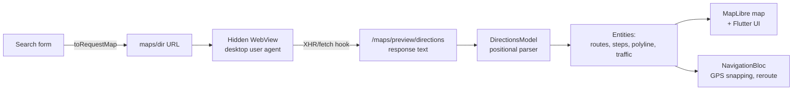

# inappwebview_map

Google Maps–quality driving directions and turn-by-turn navigation in Flutter,
**without a Google Maps API key**.

The app gets routes from Google by loading Google Maps' own directions page in
a hidden WebView and capturing the data the page receives. It then draws
everything itself on a free vector map (MapLibre + OpenFreeMap). You get
alternative routes, live traffic, road-accurate route lines, step-by-step
instructions, and Google-style navigation with rerouting.

> **Read [Caveats](#caveats) before shipping this.** It relies on Google's
> undocumented internal format and probably goes against Google Maps' Terms of
> Service.

---

## Contents

- [What it does](#what-it-does)
- [How it works](#how-it-works)
  - [1. Building the request](#1-building-the-request)
  - [2. Capturing Google's response](#2-capturing-googles-response)
  - [3. Parsing the response](#3-parsing-the-response)
  - [4. Drawing the map](#4-drawing-the-map)
  - [5. Navigation](#5-navigation)
- [Project structure](#project-structure)
- [Running it](#running-it)
- [Testing](#testing)
- [Troubleshooting](#troubleshooting)
- [Caveats](#caveats)
- [Roadmap](#roadmap)

---

## What it does

**Route overview**
- Search by place name (`Ikeja, Lagos`), by coordinates (`6.5095,3.3711`), or
  from **Your location** (the ⌖ button on the start field).
- Driving, walking, transit and cycling modes. Only driving has been verified.
- The best route plus alternatives, each with an ETA bubble on the map. Tap a
  bubble, line or card to select a route.
- Live traffic on the selected route: orange for slow, red for heavy.
- A **Steps** sheet with turn icons, distances and "Pass by …" hints. Tap a
  step to zoom to it.

**Navigation (Start)**
- A tilted, heading-up camera that follows you, with the arrow snapped to the
  road.
- A next-turn banner with the turn icon and the distance to the turn.
- A trip bar with time remaining, distance remaining, arrival time and
  **Exit**.
- The part of the route already driven turns grey.
- Panning hands the camera to you; **Re-center** takes it back.
- **Rerouting** after 3 GPS fixes in a row more than 40 m off the route.
- **Arrival** within 25 m of the destination.

---

## How it works



### 1. Building the request

`DirectionsFormState.toRequestMap()` builds a standard Google
[Maps URLs](https://developers.google.com/maps/documentation/urls/get-started)
query. It's the public link format that needs no key:

```
https://www.google.com/maps/dir/?api=1
    &origin=Ikeja, Lagos           ← text, or "lat,lng"
    &destination=6.4281,3.4219
    &travelmode=driving             ← driving | walking | transit | bicycling
```

"Your location" and reroutes send `lat,lng` (latitude first).

### 2. Capturing Google's response

`DirectionsRemoteDataSourceImpl`
([source](lib/features/directions/data/datasources/directions_remote_datasource_impl.dart))
opens that URL in a `HeadlessInAppWebView`. The user never sees the page. Four
things make this work:

| Problem | Fix |
|---|---|
| The **mobile** Maps site never receives road geometry; Google draws the route into map images on its server. | Load the page with a **desktop Chrome user agent**. The desktop site receives full route lines (it draws them itself in WebGL). |
| Mobile web shows "Open app / Stay on web", and links try to launch the Maps app (`intent://`, `comgooglemaps://`). | The desktop site doesn't show that prompt, and `shouldOverrideUrlLoading` only allows `http(s)`. |
| Some devices are redirected to `consent.google.com` ("Before you continue") and stay stuck there. | Before loading, set Google's consent cookie `SOCS=CAI` on `.google.com`. That's the **"Reject all"** answer. Google then serves Maps without personalisation. |
| The route data is buried in page traffic. | A script injected **before Google's own code** wraps `XMLHttpRequest` and `fetch`, and forwards the first `/maps/preview/directions` response body to Flutter. If the page requests it via `<link rel=preload>` (invisible to the hooks), the app fetches that URL itself once the page has loaded. |

The first response body completes the search and the WebView is disposed.
Nothing is written to disk.

If nothing arrives within **40 s**, the datasource throws
`DirectionsTimeoutException`. It reports the URL, title and visible text of
the page the WebView was stuck on, so new blockers are easy to identify (see
[Troubleshooting](#troubleshooting)).

### 3. Parsing the response

The body looks like `)]}'` followed by a JSON array **with no keys**: every
field is positional. `DirectionsModel.fromResponse`
([source](lib/features/directions/data/models/directions_model.dart)) maps it
into entities. Every lookup goes through a null-safe `_at(node, [path])`, so if
Google shifts something the field comes back null instead of crashing.

Index map (`d` = decoded array, `r` = one route):

| Path | Meaning |
|---|---|
| `d[0][0][k][4]` | waypoint *k* query text |
| `d[0][0][k][0][0][2]` | waypoint *k* coordinates `[_, _, lat, lng]` |
| `d[0][1][i]` | route *i* (0 = recommended) |
| `r[0][1]` | "via" summary, e.g. `Expressway1/E1` |
| `r[0][2]` / `r[0][3]` | distance `[m, "32.0 km"]` / free-flow duration `[s, "42 min"]` |
| `r[0][10][0]` | duration **in traffic** `[s, "51 min"]` (the headline ETA) |
| `r[0][10][4][2]` | typical range, e.g. `"37 min to 1 hr 13 min"` |
| `r[3][5][0][k]` | traffic span `[level, start_m, length_m]`; level 1 = heavy, 2 = slow |
| `r[1][0][1][g][1][s]` | step *s* of step group *g* |
| `…[s][2][1]` | turn icon CSS class, e.g. `dir-tt dir-tt-turn-left` |
| `…[s][0][1]` | instruction markup `<step maneuver='TURN' …>` (some steps only) |
| `…[s][0][14]` | instruction as text parts |
| `…[s][0][9][0][1]` | hint, e.g. `Pass by Abiglow (on the left)` |
| `…[s][0][2]` / `[3]` | step distance / duration |
| `…[s][0][7][2]` | maneuver location `[_, _, lat, lng]` |
| `d[0][7][i]` | **route *i* geometry (desktop only)**: `[0]` lats, `[1]` lngs |

**Geometry encoding.** Values are integers in units of 1e-7 degrees. The first
value is absolute and each following one is a change from the previous point:

```dart
lat += lats[i]; lng += lngs[i];
point = LatLng(lat / 1e7, lng / 1e7);
```

To check it: the decoded polylines measure 31,956 m / 34,212 m / 35,151 m
against Google's stated 31,956 / 34,212 / 35,152 m. Points are a median 20 m
apart.

The mobile ("Lite") response has no `d[0][7]`. The parser then falls back to
origin → maneuver points → destination and sets
`hasDetailedPolyline = false`.

### 4. Drawing the map

`RouteMap` ([source](lib/features/directions/presentation/widgets/route_map.dart))
uses **MapLibre** with the free **OpenFreeMap "liberty"** vector style (no key).
Everything is GeoJSON layers:

- `routes`: casing and fill line layers, ordered by a `z` property.
  Alternatives are light blue, the selected route is Google blue, and traffic
  slices are drawn on top. Feature ids `route-<i>` make lines tappable.
- `labels`: ETA bubbles. They are bitmaps drawn with `dart:ui` in
  [`map_images.dart`](lib/features/directions/presentation/widgets/map_images.dart),
  so there are no asset files. Each bubble sits where its route is farthest
  from the others (`DirectionsEntity.labelPointFor`).
- `markers`: start dot, destination pin, focused-step dot.
- `puck`: the navigation arrow, rotated to the bearing and drawn flat on the
  tilted map.

Camera modes: an **overview** that fits all routes north-up, a **step focus**
that zooms to one maneuver, and a **follow** mode while navigating: zoom 17.3,
55° tilt, heading-up, aimed 90 m ahead so the arrow sits in the lower third.

### 5. Navigation

`NavigationBloc` ([source](lib/features/directions/presentation/bloc/navigation_bloc.dart))
listens to `geolocator`'s position stream. On every fix:

1. **Snap** the fix to the route (`RouteEntity.locate`). This is a projection
   onto each segment, searched near the last known progress so it doesn't jump
   onto a parallel stretch.
2. Update progress: the current step (`stepIndexAt`), the distance to the next
   maneuver, the time remaining (the traffic ETA scaled by the distance left)
   and the bearing (route direction 40 m ahead, for a steady camera).
3. **Off-route:** after 3 fixes in a row more than 40 m from the route (or the
   GPS accuracy, if larger), it shows "Rerouting…". It then requests
   directions again with `origin = current lat,lng`, keeping the same
   destination and mode. Fixes that arrive during the reroute are dropped.
4. **Arrived:** within 25 m of the end.

---

## Project structure

Clean architecture: `data` → `domain` ← `presentation`, wired with `get_it`
in `lib/core/di/`.

```
lib/
├── core/                         Failure types, RequestParam, context extensions, DI
└── features/directions/
    ├── data/
    │   ├── datasources/
    │   │   ├── directions_remote_datasource_impl.dart   hidden WebView + capture
    │   │   └── location_datasource_impl.dart            geolocator
    │   ├── models/directions_model.dart                 the positional parser
    │   └── repositories/                                exceptions → Either<Failure, T>
    ├── domain/
    │   ├── entities/      Directions, Route (snapping, slicing, bearing), Step,
    │   │                  TrafficSpan, LatLng, UserLocation, TravelMode
    │   ├── repositories/  contracts
    │   └── use_cases/     GetDirections, GetCurrentLocation, WatchLocation,
    │                      EnsureLocationPermission
    └── presentation/
        ├── bloc/          DirectionsBloc (search + selection), DirectionsFormCubit
        │                  (form, is the RequestParam), NavigationBloc
        ├── pages/directions_page.dart
        └── widgets/       route_map, route_options_bar, route_steps_sheet,
                           directions_search_panel, navigation_overlay, map_images

test/
├── directions_model_test.dart    parser + route maths against real captures
└── fixtures/                     captured desktop and Lite responses
tool/simulate_drive.py            drives the emulator's GPS along a route
docs/low_end_device_plan.md       parked performance plan for budget phones
```

`lib/route_probe.dart` and `lib/map_html.dart` are left over from the
investigation and aren't used by the app.

---

## Running it

```bash
flutter pub get
flutter run
```

On launch the app searches "Ikeja, Lagos" → "Lekki Phase 1, Lagos" so there's
something to look at.

**Android notes**
- Location permissions are in `AndroidManifest.xml`.
- `android/build.gradle.kts` pins
  `com.google.android.gms:play-services-location` to **21.3.0** for all modules.
  MapLibre pulls in 21.4.0, which is built with Kotlin 2.3, and this project's
  Kotlin plugin is 2.1. Remove the pin after upgrading Kotlin.

**iOS:** `NSLocationWhenInUseUsageDescription` is set in `Info.plist`. iOS
hasn't been built or tested yet.

---

## Testing

**Unit tests** run the parser and route maths against real captured responses:

```bash
flutter test
```

**Simulated drive on the emulator.** Start navigation on the Ikeja → Lekki
best route in the app, then in another terminal run:

```bash
python3 tool/simulate_drive.py
```

It moves the emulator's GPS along route 0 of the fixture at 15 m/s. You can
pass a route index, start/end metres and speed:

```bash
python3 tool/simulate_drive.py test/fixtures/directions_desktop.txt 0 0 2000 20
```

**Placing the emulator somewhere:** use Extended controls (⋯) → Location, or
the command below. Note that it takes **longitude first**.

```bash
~/Library/Android/sdk/platform-tools/adb emu geo fix 3.3792 6.5244
```

To trigger a reroute, move the GPS 100 m or more off the route for a few
seconds.

---

## Troubleshooting

**"Google Maps took too long to respond. Stuck on: …"** The text after
"Stuck on" is the page the hidden WebView ended up on:

| Stuck on | Meaning / fix |
|---|---|
| `consent.google.com/…` | The consent cookie didn't stick. Check `_setConsentCookie`. |
| `www.google.com/sorry/…` or "unusual traffic" | Google is rate-limiting this IP (common on shared mobile data). Wait, or fall back. |
| `accounts.google.com/…` | A sign-in wall. |
| `www.google.com/maps/dir/…` with no route | The search loaded but never requested directions. Usually Google changed something (see below), or the place wasn't recognised and Google is showing a place list. |

Full load/error logs are printed with the `[directions]` prefix:

```bash
adb logcat | grep '\[directions\]'
```

**"Unexpected directions format: …"** Google changed the response layout. To
re-map it:
1. Capture a fresh response, for example by temporarily logging the body in
   `DirectionsRemoteDataSourceImpl`, or by wiring `RouteProbe` back up.
2. Save it as a fixture under `test/fixtures/`.
3. Fix the index paths in `DirectionsModel` until `flutter test` passes.

**The line runs a few metres beside the road.** This is expected in places.
The route geometry comes from Google and the base map from OpenStreetMap, and
they don't line up exactly.

---

## Caveats

- **Terms of Service.** This scrapes Google Maps' web client. That's very
  likely against Google Maps' Terms of Service. The supported way to get the
  same data is the paid Routes API.
- **Fragile.** The capture depends on the `/maps/preview/directions` URL and
  the response depends on positional indexes. Either can change with any
  Google release, without notice.
- **Consent on users' behalf.** The app answers Google's consent prompt with
  "Reject all" inside the hidden WebView. Mention this in your privacy policy.
- **Speed and data.** Each search loads the full desktop Maps site in the
  background: about 3–10 s, and several MB of downloads on the first search.
- **No background navigation.** Location updates stop when the app is in the
  background or the screen is locked.
- **ETA isn't live.** Time remaining is scaled from Google's original ETA and
  only refreshes when a reroute happens.
- **Tested so far:** the Android emulator and a Galaxy S21 Ultra, debug builds,
  driving mode, Lagos. Budget phones, release builds, iOS and other travel
  modes are untested.

---

## Roadmap

- **Fallback to the Google Maps app** when a search fails, times out or keeps
  failing to reroute. Open the same `maps/dir/?api=1&…` URL externally (e.g.
  with `url_launcher`) to hand the trip over.
- **Low-end phone performance.** See
  [docs/low_end_device_plan.md](docs/low_end_device_plan.md): block tiles and
  images in the hidden WebView, keep one warm WebView, cache route distances,
  update only the arrow each GPS fix.
- **Background location** so navigation keeps going with the screen off.
- **Place search / autocomplete**, and handling Google's "pick a place" list.
- Verify **walking, cycling and transit** responses.
- **iOS** build and test.
